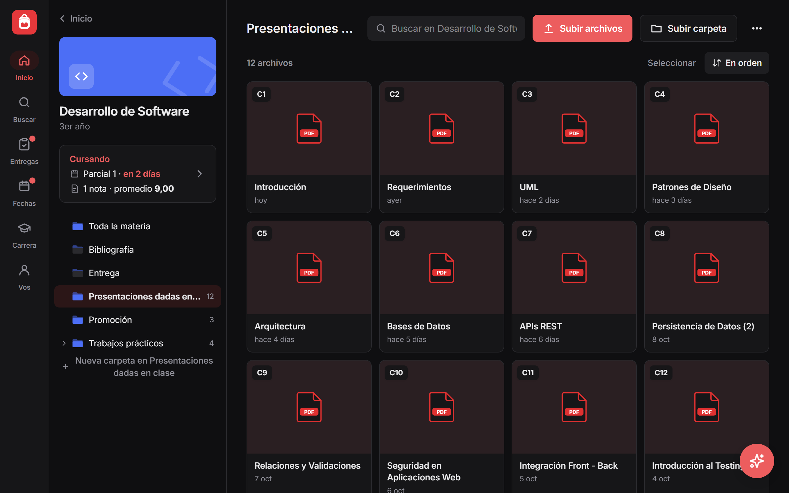
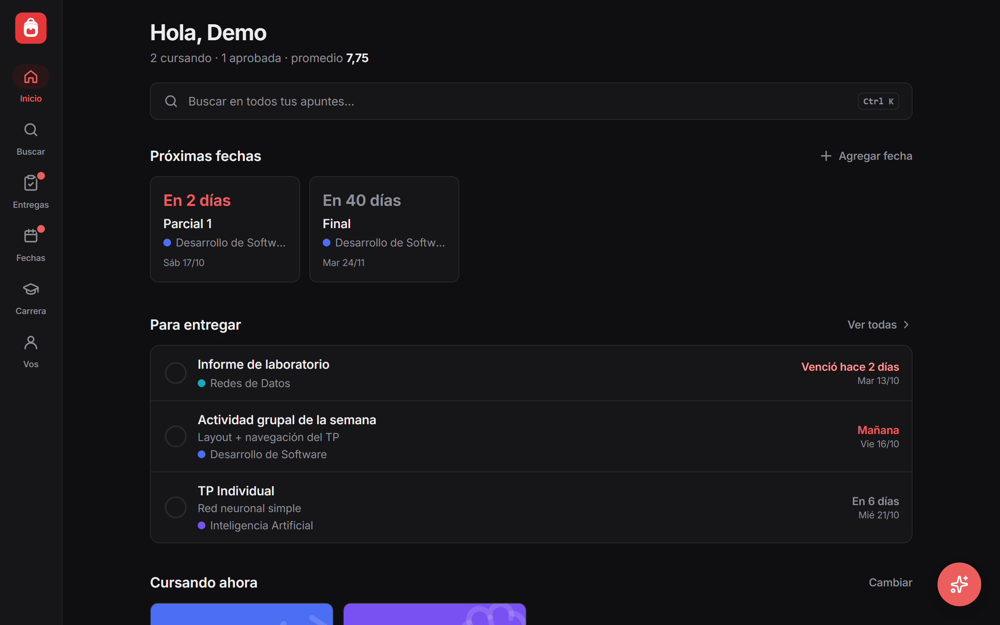
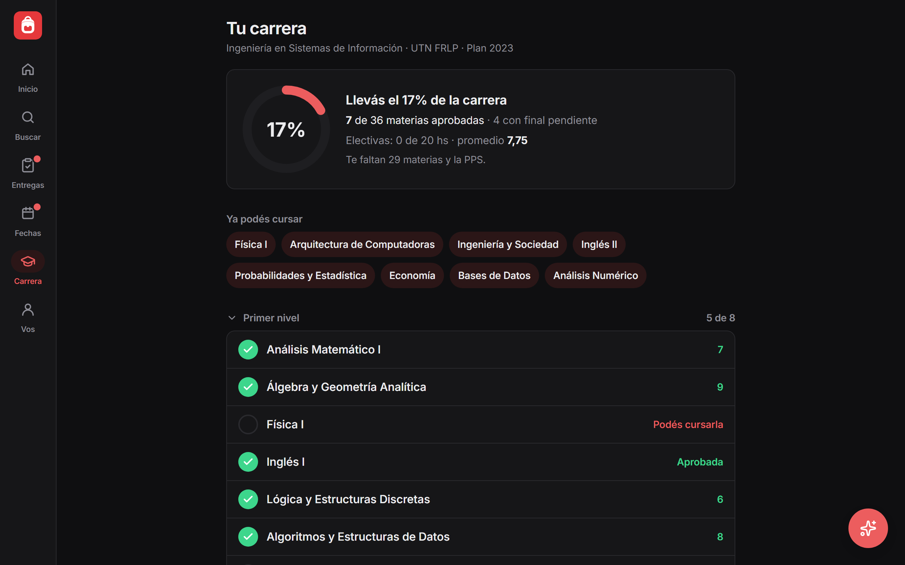

<p align="center">
  
</p>

<h1 align="center">Mochi</h1>

<p align="center">
  Los apuntes de la facultad ordenados, en la compu y en el celu.<br />
  Todo se guarda en tu propio Google Drive.
</p>

<p align="center">
  <a href="https://mochi-facu.vercel.app"><b>mochi-facu.vercel.app</b></a>
</p>

<p align="center">
  
</p>

## Por qué

Los apuntes terminan repartidos entre el Drive, WhatsApp, la compu y el celu, y Notion se vuelve un desorden.
Mochi los junta en un solo lugar con una estructura simple: **año → materia → carpetas**.

Los archivos son tuyos: quedan en una carpeta **Facultad** de tu Google Drive, en carpetas normales.
Si algún día la app deja de andar, todo sigue ahí.

## Qué tiene

| | |
|---|---|
| **Materias** | Carpetas y subcarpetas libres, vista previa de PDF, Word, Excel y fotos, nombres de clase ordenados (C2 antes que C10). Subir archivos o carpetas enteras arrastrándolas. |
| **Buscador** | Busca por nombre y también **adentro** de los PDF y Word. |
| **Entregas** | TPs y actividades con fecha. Se tildan al entregarlas y avisa lo atrasado. |
| **Fechas** | Parciales y finales con cuenta regresiva y link para agregarlos a Google Calendar. |
| **Carrera** | Plan de estudios con correlativas: qué aprobaste, qué podés cursar y **qué porcentaje de la carrera llevás**. |
| **Notas** | Notas de parciales y finales, y promedio con dos decimales. |
| **Mochi (IA)** | Un asistente con Gemini que lee tus apuntes: resume, toma preguntas, busca y ordena (siempre pidiendo confirmación). |
| **Compartir** | Pasale una carpeta a un compañero con un link y se la copia a su Mochi. |
| **Sin conexión** | Los archivos que guardes se abren sin internet. Se instala como app en el celu. |

<table>
  <tr>
    <td></td>
    <td></td>
  </tr>
  <tr>
    <td align="center">Inicio</td>
    <td align="center">Carrera</td>
  </tr>
</table>

## Cómo está hecha

- **Frontend:** React 18, TypeScript, Vite y Tailwind CSS. Es una PWA: se instala y funciona sin conexión.
- **Archivos:** Google Drive API desde el navegador, con el permiso `drive.file` (la app solo ve lo que se subió desde la app).
- **Sesión:** inicio con Google en una función de Vercel; la sesión queda cifrada en una cookie.
- **IA:** Gemini, con herramientas que se ejecutan en el navegador sobre tu Drive.
- **Datos chicos** (fechas, notas, entregas, avance de la carrera): un archivo JSON dentro de la carpeta Facultad.
- **Lectores:** PDF.js, Mammoth (Word) y SheetJS (Excel).

## Probarla en la compu

```bash
npm install
npm run dev
```

Abrí <http://localhost:5173/?demo> para verla con datos de prueba, sin cuenta.

Para usarla con tu cuenta de Google hay que crear las credenciales una sola vez: los pasos están en
[docs/CONFIGURACION.md](docs/CONFIGURACION.md).

Todo lo que se sube a `main` se publica solo en Vercel.

## Privacidad

Mochi no guarda tus archivos en ningún servidor: van directo de tu navegador a tu Google Drive.
Más detalle en la [política de privacidad](https://mochi-facu.vercel.app/privacidad).
